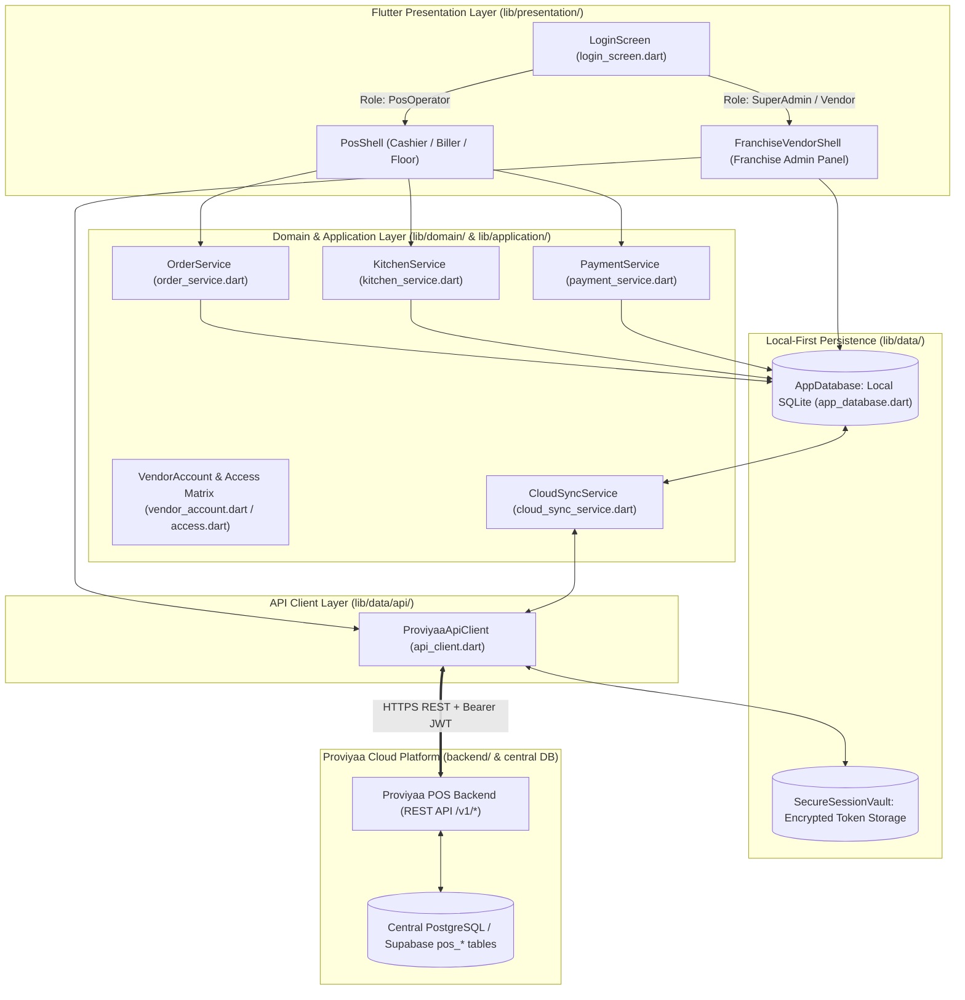
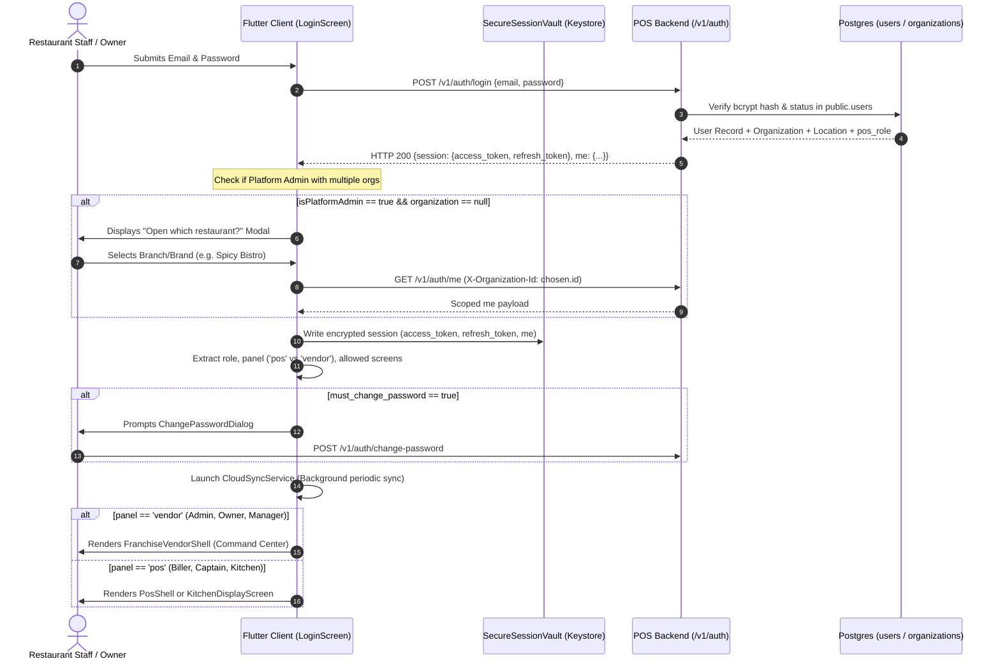
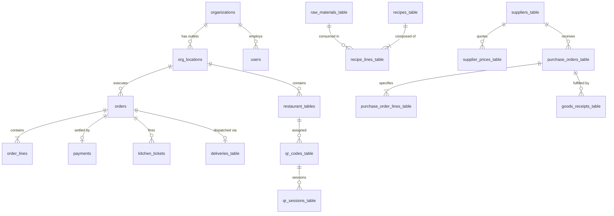
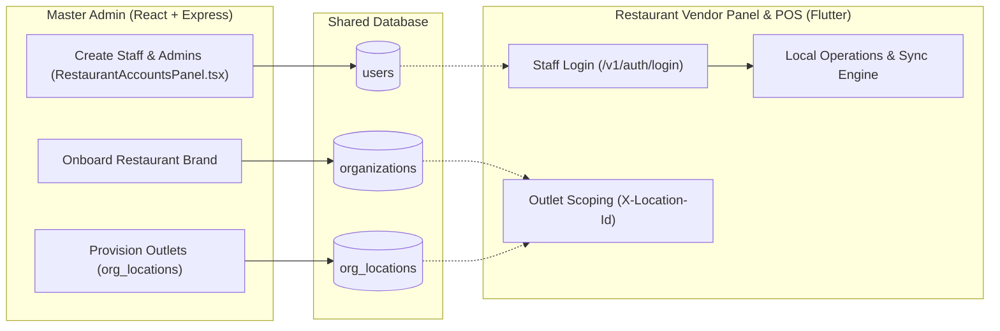

# RESTAURANT VENDOR PANEL CODEBASE AUDIT & ARCHITECTURE REPORT
**Project:** OneLatur / Proviyaa — Restaurant Vendor Panel & POS  
**Audit Date:** September 29, 2026  
**Auditor Roles:** Senior Software Architect, Flutter Developer, Backend Engineer, Database Architect, and Technical Auditor  
**Target Audience:** Technical Leadership, Architects, AI Engineering Assistants (ChatGPT)

---

## 1. Executive Summary

This report presents a forensic audit of the **OneLatur / Proviyaa Restaurant Vendor Panel and POS terminal** codebase located at [`d:\Projects\Proviyaa-pos\Proviyaa-Pos-`](file:///d:/Projects/Proviyaa-pos/Proviyaa-Pos-).

The application is an enterprise-grade, **local-first (offline-resilient) restaurant operations platform** built using **Flutter (Dart 3.x)**. It bridges physical in-store restaurant operations (dining floor, KOT kitchen displays, takeaway, POS cashier billing, table reservations) with multi-branch franchise chain back-office operations (recipe costing, raw material inventory, purchase orders, staff management, payroll, and corporate compliance).

### Key Architectural Findings:
1. **Zero Direct Supabase Coupling from App**: Despite earlier design drafts referencing Supabase clients, the Flutter application contains **no Supabase client SDK** and **no direct database credentials**. All cloud communications are mediated exclusively by the Proviyaa Node.js API backend ([`backend/`](file:///d:/Projects/Proviyaa-pos/Proviyaa-Pos-/backend)) via standard HTTP REST endpoints.
2. **Dual-Role Single Binary Architecture**: The application dynamically partitions into two distinct user experiences driven by server-resolved claims (`GET /v1/auth/me`):
   - **Floor Roles** (`biller`, `captain`, `kitchen`, `staff_user`): Routed to the **POS Terminal Shell** ([`lib/presentation/pos_shell.dart`](file:///d:/Projects/Proviyaa-pos/Proviyaa-Pos-/lib/presentation/pos_shell.dart)) or dedicated Kitchen Display.
   - **Executive / Management Roles** (`org_owner`, `org_admin`, `manager`, `inventory_manager`, `hr_manager`): Routed to the comprehensive **Franchise Vendor Shell** ([`lib/presentation/franchise/franchise_vendor_shell.dart`](file:///d:/Projects/Proviyaa-pos/Proviyaa-Pos-/lib/presentation/franchise/franchise_vendor_shell.dart)) with multi-branch navigation.
3. **Local-First Drift/SQLite Engine**: The app embeds a Drift relational database ([`lib/data/app_database.dart`](file:///d:/Projects/Proviyaa-pos/Proviyaa-Pos-/lib/data/app_database.dart)) with 25+ local tables. Core restaurant operations (punching orders, firing KOTs, settling cash payments, editing menus) persist to local SQLite first. An asynchronous bidirectional synchronization service ([`lib/application/cloud_sync_service.dart`](file:///d:/Projects/Proviyaa-pos/Proviyaa-Pos-/lib/application/cloud_sync_service.dart)) synchronizes changes to central Postgres whenever an internet connection is available.
4. **Implementation Reality Check**:
   - Operations, Billing, Menu, Kitchen, Staff Management, Recipes, and Inventory are **deeply functional** and wired to SQLite/APIs.
   - External digital payments (Card, UPI / Razorpay / Paytm) and third-party delivery aggregators (Swiggy / Zomato order push APIs) are **deliberately blocked or stubbed** with honest guardrails pending official certified payment provider integrations.

---

## 2. Project Overview

- **Application Name:** `proviyaa_pos`
- **Application Description:** Local-first Restaurant POS and Multi-Outlet Franchise Command Panel.
- **Repository Root:** [`d:\Projects\Proviyaa-pos\Proviyaa-Pos-`](file:///d:/Projects/Proviyaa-pos/Proviyaa-Pos-)
- **Ecosystem:**
  - **Flutter App (`lib/`):** Restaurant Vendor Panel & POS Terminal.
  - **POS Backend (`backend/`):** Node.js / TypeScript Hono/Express service handling authentication, multi-tenant RBAC, live franchise metrics calculation, and the `/v1/sync` protocol.
  - **Master Admin (`master-admin/`):** React 18 + Express web control plane used by platform super-admins to onboard restaurant brands, provision outlets, and issue credentials.
  - **Central Database (`supabase/migrations/`):** Central PostgreSQL database hosting 21+ `pos_*` tables with Row Level Security (RLS) enabled.

---

## 3. Technology Stack

- **Flutter / Dart SDK:** Dart SDK `>=3.0.0 <4.0.0` (Flutter 3.x), configured in [`pubspec.yaml`](file:///d:/Projects/Proviyaa-pos/Proviyaa-Pos-/pubspec.yaml).
- **Local Persistence:**
  - `drift: ^2.35.0` (Type-safe SQLite ORM)
  - `drift_flutter: ^0.3.1` (Platform storage binder with native sqlite3 / WASM OPFS support)
  - `drift_sqlite_async: ^0.3.1`
- **Networking & Auth Security:**
  - `http: ^1.6.0` (Configured through custom wrapper [`ProviyaaApiClient`](file:///d:/Projects/Proviyaa-pos/Proviyaa-Pos-/lib/data/api/api_client.dart))
  - `flutter_secure_storage: ^11.2.0` (Platform Keystore / Keychain for encrypted JWT session tokens)
  - `crypto: ^3.0.6` (SHA-256 change hashing for sync intents)
  - `uuid: ^4.6.0` (Client-side UUIDv4 primary key generation)
- **File & Media Handling:**
  - `file_picker: ^13.1.0` (CSV import/export and image upload)
- **Spike / Evaluation Packages:**
  - `powersync: ^2.4.0` (Evaluated in [`powersync_connector_spike.dart`](file:///d:/Projects/Proviyaa-pos/Proviyaa-Pos-/lib/data/powersync_connector_spike.dart), but unused in production).
- **Design System:** Material 3 with bespoke high-density typography (`Inter`, `Geist`) and dark/light color palette defined in [`lib/presentation/vinii_theme.dart`](file:///d:/Projects/Proviyaa-pos/Proviyaa-Pos-/lib/presentation/vinii_theme.dart).

---

## 4. Architecture Overview

### High-Level Architecture Diagram



---

## 5. Complete Project Structure

```
d:/Projects/Proviyaa-pos/Proviyaa-Pos-/lib/
├── application/                     # Application services & business logic orchestrators
│   ├── auth_service.dart            # Online login & 24hr offline grant management
│   ├── cloud_sync_service.dart      # Bidirectional delta sync engine (pull first, push dependencies)
│   ├── kitchen_service.dart         # KOT creation, status forward transitions
│   ├── order_service.dart           # Validated order generation with client UUID
│   ├── payment_service.dart         # Idempotent cash settlement service
│   ├── shift_service.dart           # Register cash float, shift opening/closing
│   └── sync_worker.dart             # Outbox queue retry runner interface
├── config/                          # Configuration & environment variables
│   └── app_config.dart              # Reads APP_ENV, DATA_MODE, PROVIYAA_API_BASE_URL
├── data/                            # Database stores, repositories, seeders, sync contracts
│   ├── api/                         # Backend REST client & secure session vault
│   │   ├── api_client.dart          # HTTP client, token auto-refresh, error parsing
│   │   ├── api_online_orders_store.dart # Long-poll backend inbox for web/app orders
│   │   └── session_vault.dart       # Encrypted keystore wrapper for JWTs
│   ├── sync/                        # Sync table contracts and schema mapping
│   │   ├── sync_contract.dart       # Mapping between 24 SQLite tables and backend resources
│   │   └── sync_tables.dart         # Sync bookkeeping and outbox Drift tables
│   ├── app_database.dart            # Drift SQLite database definition (all tables)
│   ├── app_database.g.dart          # Generated Drift code (~836 KB)
│   ├── drift_all_orders_store.dart  # Local order history query store
│   ├── drift_inventory_store.dart   # Raw materials, suppliers, POs, GRN SQLite store
│   ├── drift_kitchen_store.dart     # Kitchen ticket local persistence
│   ├── drift_local_store.dart       # Active shift & pending order storage
│   ├── drift_master_store.dart      # Central menu dishes, recipes, offers, media store
│   ├── drift_menu_store.dart        # POS menu categories and items store
│   ├── drift_operations_store.dart  # Dining tables, floors, reservations, QR codes store
│   ├── drift_payment_store.dart     # Local cash payments store
│   ├── drift_table_store.dart       # Floor plan tables and status watcher
│   ├── franchise_catalog.dart       # Mock/reference data for franchise benchmarking
│   ├── franchise_repository.dart    # Abstract & API repository for franchise operations
│   ├── master_catalog.dart          # Default master catalogue items & categories
│   ├── master_seeder.dart           # SQLite seeder for fresh device initialization
│   ├── operations_seeder.dart       # Floor plan and live dining tables seeder
│   ├── spicy_bistro_seeder.dart     # Multi-outlet test seed dataset
│   ├── staff_repository.dart        # Abstract & API repository for staff, HR, payroll
│   └── staff_repository_memory.dart # Offline demo/in-memory staff repository
├── domain/                          # Pure business entities, models, and permission rules
│   ├── access.dart                  # Screen catalog and default role-to-screen matrix
│   ├── dine_in_status.dart          # Table dine-in status types
│   ├── franchise_models.dart        # Chain KPI metrics, recommendations, rank models
│   ├── inventory.dart               # Raw materials, BOM lines, POs, supplier quotes
│   ├── kitchen_ticket.dart          # KOT entity and linear status transitions
│   ├── master.dart                  # Offers, campaigns, recipes, media asset records
│   ├── menu.dart                    # Menu category & menu item entities
│   ├── operations.dart              # OpsTable, OpsOrder, OpsKot, OpsDelivery, QR models
│   ├── order.dart                   # LocalOrder, OrderLine, OrderType
│   ├── payment.dart                 # CashPayment entity
│   ├── restaurant_table.dart        # Table zones and occupancy models
│   ├── shift.dart                   # Register shift float and cash variance models
│   ├── staff_session.dart           # Offline authorization grant model
│   ├── sync_intent.dart             # Outbox command model
│   └── vendor_account.dart          # Authenticated user claims, outlets, roles, capabilities
├── presentation/                    # UI screens, widgets, modals, and design tokens
│   ├── franchise/                   # Multi-branch franchise chain back-office
│   │   ├── branch_detail_screen.dart           # Single branch KPI, health score, safety stock
│   │   ├── branch_performance_screen.dart      # Comparative branch leaderboard
│   │   ├── compliance_audit_screen.dart        # Audits, hygiene checklists, license renewals
│   │   ├── franchise_command_center_screen.dart # Chainwide overview & stock rebalancing
│   │   ├── franchise_exceptions_screen.dart    # Stockouts, margin drops, action center
│   │   ├── franchise_inventory_screen.dart     # Chainwide inventory matrix & transfer POs
│   │   ├── franchise_vendor_shell.dart         # Navigation shell for Vendor Admin
│   │   ├── restaurant_dashboard_screen.dart    # High-density operational analytics dashboard
│   │   └── targets_benchmarking_screen.dart    # Corporate target setting & amendment
│   ├── master/                      # Master catalogue, BOM recipes, and inventory procurement
│   │   ├── add_edit_menu_item_modal.dart       # Comprehensive menu creation dialog (9 tabs)
│   │   ├── master_inventory_screen.dart        # Raw material inventory catalog & reorder levels
│   │   ├── master_media_screen.dart            # Media assets & photo asset manager
│   │   ├── master_menu_items_screen.dart       # Master menu dish manager
│   │   ├── master_offers_screen.dart           # Promotional discount campaigns
│   │   ├── master_products_online_screen.dart  # Channel-specific price overrides (Swiggy/Zomato)
│   │   ├── master_purchase_orders_screen.dart  # PO creation, approval, and GRN receiving
│   │   ├── master_recipes_screen.dart          # 10-stage recipe engineering & BOM costing
│   │   ├── master_suppliers_screen.dart        # Supplier profiles and live price quotes
│   │   └── master_ui.dart                      # Common design components (tables, badges, dialogs)
│   ├── operations/                  # Floor operations & live restaurant execution
│   │   ├── ops_captain_orders_screen.dart      # Captain ordering screen with visual floor plan
│   │   ├── ops_delivery_screen.dart            # Delivery dispatch board & rider assignment
│   │   ├── ops_dine_in_screen.dart             # Dining table canvas & table status details
│   │   ├── ops_kitchen_screen.dart             # KOT display & KDS station routing
│   │   ├── ops_live_operations_screen.dart     # Unified live order tracking Kanban
│   │   ├── ops_pos_billing_screen.dart         # Cashier billing terminal & payment settlement
│   │   ├── ops_qr_ordering_screen.dart         # Tabletop QR generation & live guest carts
│   │   └── ops_reservations_screen.dart        # Table booking schedule & timeline view
│   ├── staff/                       # Staff HR, biometric/manual attendance, and payroll
│   │   ├── advances_tab.dart                   # Salary advance requests and tracking
│   │   ├── approvals_tab.dart                  # Managerial approval queue (leaves, advances)
│   │   ├── attendance_tab.dart                 # Daily staff attendance register
│   │   ├── audit_log_tab.dart                  # Audit trail of employee operations
│   │   ├── login_security_tab.dart             # Staff login credentials & password reset
│   │   ├── reports_tab.dart                    # Payroll, attendance, and advance CSV reports
│   │   ├── roles_tab.dart                      # Role definition & capability matrices
│   │   ├── salary_tab.dart                     # Monthly salary generator with OT and deductions
│   │   ├── shifts_tab.dart                     # Staff roster and shift scheduling
│   │   ├── staff_dashboard_tab.dart            # HR metric summary and quick employee creation
│   │   ├── staff_directory_tab.dart            # Employee profiles, bank details, contracts
│   │   ├── staff_management_screen.dart        # Staff management host screen with tab controller
│   │   └── training_tab.dart                   # Training modules and staff quiz evaluations
│   ├── all_orders_screen.dart       # POS order history listing
│   ├── change_password_dialog.dart  # Mandatory first-login password update modal
│   ├── delivery_screen.dart         # Simple POS delivery orders view
│   ├── dine_in_screen.dart          # Simple POS table overview
│   ├── kitchen_display_screen.dart  # Standalone POS kitchen display screen
│   ├── login_screen.dart            # Dual-mode authentication screen
│   ├── menu_management_screen.dart  # Basic POS category/item editor
│   ├── online_orders_screen.dart    # Aggregator & web order acceptance screen
│   ├── payment_screen.dart          # Cash payment collection modal
│   ├── pos_order_screen.dart        # Full POS order-taking canvas
│   ├── pos_shell.dart               # POS Terminal chrome (sidebar + top bar)
│   ├── pos_sidebar.dart             # Left-hand navigation rail for POS operators
│   ├── pos_top_bar.dart             # POS header bar with search and quick actions
│   ├── tables_screen.dart           # POS table grid view
│   ├── takeaway_screen.dart         # POS takeaway order queue
│   └── vinii_theme.dart             # Brand color tokens, themes, typography
└── main.dart                        # Main application bootstrap, state root, and session router
```

---

## 6. Complete Feature and Module Inventory

| Module / Feature | Screen / File Location | Target User | Main Actions | Data Store / APIs | Status |
| :--- | :--- | :--- | :--- | :--- | :--- |
| **Authentication & Session Restore** | [`login_screen.dart`](file:///d:/Projects/Proviyaa-pos/Proviyaa-Pos-/lib/presentation/login_screen.dart) | All Staff & Admins | Sign in, reset password, auto-restore encrypted session, offline fallback | `POST /v1/auth/login`, `POST /v1/auth/refresh`, `flutter_secure_storage` | **FULLY IMPLEMENTED** |
| **Restaurant Command Center (Franchise)** | [`franchise_command_center_screen.dart`](file:///d:/Projects/Proviyaa-pos/Proviyaa-Pos-/lib/presentation/franchise/franchise_command_center_screen.dart) | Chain Owner / Exec | View chainwide sales, AOV, food cost %, execute stock rebalance transfers | `GET /v1/franchise/overview`, `POST /v1/franchise/stock-transfers` | **FULLY IMPLEMENTED** |
| **Branch Performance Leaderboard** | [`branch_performance_screen.dart`](file:///d:/Projects/Proviyaa-pos/Proviyaa-Pos-/lib/presentation/franchise/branch_performance_screen.dart) | Franchise Admin | Compare branch revenue, target attainment %, health score, filter by city | `GET /v1/franchise/branch-performance` | **FULLY IMPLEMENTED** |
| **Branch Detail View** | [`branch_detail_screen.dart`](file:///d:/Projects/Proviyaa-pos/Proviyaa-Pos-/lib/presentation/franchise/branch_detail_screen.dart) | Branch / Brand Mgr | View single branch incidents, daily P&L deficit, safety stock adjustments | Local catalog reference (`FranchiseCatalog`) | **PARTIALLY IMPLEMENTED** (UI + Mock Data) |
| **Chainwide Inventory Matrix** | [`franchise_inventory_screen.dart`](file:///d:/Projects/Proviyaa-pos/Proviyaa-Pos-/lib/presentation/franchise/franchise_inventory_screen.dart) | Procurement Mgr | Matrix view of raw materials across all branches, approve inter-branch transfers | `GET /v1/franchise/inventory`, `POST /v1/franchise/stock-transfers` | **FULLY IMPLEMENTED** |
| **Operational Exceptions Center** | [`franchise_exceptions_screen.dart`](file:///d:/Projects/Proviyaa-pos/Proviyaa-Pos-/lib/presentation/franchise/franchise_exceptions_screen.dart) | Operations Director | Review stockout warnings, gross margin anomalies, bulk-resolve issues | `GET /v1/franchise/exceptions`, `POST /v1/franchise/exceptions/:id/resolve` | **FULLY IMPLEMENTED** |
| **Corporate Targets & Benchmarking** | [`targets_benchmarking_screen.dart`](file:///d:/Projects/Proviyaa-pos/Proviyaa-Pos-/lib/presentation/franchise/targets_benchmarking_screen.dart) | Finance Manager | Amend corporate target ratios (food cost %, wastage %, labor cost %) | `GET /v1/franchise/records?type=target_amendment`, `POST /v1/franchise/records` | **FULLY IMPLEMENTED** |
| **Compliance & Food Safety Audits** | [`compliance_audit_screen.dart`](file:///d:/Projects/Proviyaa-pos/Proviyaa-Pos-/lib/presentation/franchise/compliance_audit_screen.dart) | Compliance Auditor | Log food safety inspection grades, track license renewals, upload audit notes | `GET /v1/franchise/records?type=audit_report`, `POST /v1/franchise/records` | **FULLY IMPLEMENTED** |
| **High-Density Analytics Dashboard** | [`restaurant_dashboard_screen.dart`](file:///d:/Projects/Proviyaa-pos/Proviyaa-Pos-/lib/presentation/franchise/restaurant_dashboard_screen.dart) | General Manager | Visual breakdown of hourly sales, leakage, aggregator vs direct shares | In-memory formulas with dynamic multipliers | **MOCK DATA** (UI Complete, Math dynamic, not wired to real order DB) |
| **Master Menu Catalog** | [`master_menu_items_screen.dart`](file:///d:/Projects/Proviyaa-pos/Proviyaa-Pos-/lib/presentation/master/master_menu_items_screen.dart) | Menu Manager / Chef | CRUD menu dishes, categories, kitchen routing stations, tax slabs, CSV import/export | Drift `menu_items_table`, `menu_categories_table` | **FULLY IMPLEMENTED** |
| **Channel-Specific Price Overrides** | [`master_products_online_screen.dart`](file:///d:/Projects/Proviyaa-pos/Proviyaa-Pos-/lib/presentation/master/master_products_online_screen.dart) | Marketing Manager | Set markup prices specifically for Swiggy, Zomato, or Direct Website channels | Drift `menu_items_table` (`channelPrices` JSON payload) | **FULLY IMPLEMENTED** |
| **Media Asset Library** | [`master_media_screen.dart`](file:///d:/Projects/Proviyaa-pos/Proviyaa-Pos-/lib/presentation/master/master_media_screen.dart) | Marketing Manager | Upload dish photos, organize by folders, tag usage labels | Drift `media_assets_table` | **FULLY IMPLEMENTED** (Local storage; Cloud bucket upload pending) |
| **Promotional Offers & Campaigns** | [`master_offers_screen.dart`](file:///d:/Projects/Proviyaa-pos/Proviyaa-Pos-/lib/presentation/master/master_offers_screen.dart) | Marketing Manager | Create coupon codes (flat off, percentage off), set minimum spend, valid dates | Drift `offers_table` | **FULLY IMPLEMENTED** |
| **Raw Material Inventory & Stock** | [`master_inventory_screen.dart`](file:///d:/Projects/Proviyaa-pos/Proviyaa-Pos-/lib/presentation/master/master_inventory_screen.dart) | Store Manager | Track physical quantities, reorder thresholds, maximum storage limits | Drift `raw_materials_table`, `stock_movements_table` | **FULLY IMPLEMENTED** |
| **10-Stage Recipe Lifecycle & BOM** | [`master_recipes_screen.dart`](file:///d:/Projects/Proviyaa-pos/Proviyaa-Pos-/lib/presentation/master/master_recipes_screen.dart) | Executive Chef | Bill of Materials (BOM) per portion, wastage %, live food cost recalculation | Drift `recipes_table`, `recipe_lines_table` | **FULLY IMPLEMENTED** |
| **Suppliers & Price Quotes** | [`master_suppliers_screen.dart`](file:///d:/Projects/Proviyaa-pos/Proviyaa-Pos-/lib/presentation/master/master_suppliers_screen.dart) | Purchase Manager | Manage vendor directories, track multi-supplier ingredient prices | Drift `suppliers_table`, `supplier_prices_table` | **FULLY IMPLEMENTED** |
| **Purchase Orders & Goods Receiving (GRN)** | [`master_purchase_orders_screen.dart`](file:///d:/Projects/Proviyaa-pos/Proviyaa-Pos-/lib/presentation/master/master_purchase_orders_screen.dart) | Procurement / Store | Generate POs, approve purchasing, receive deliveries via GRN, auto-adjust stock | Drift `purchase_orders_table`, `goods_receipts_table` | **FULLY IMPLEMENTED** |
| **Live Operations Kanban** | [`ops_live_operations_screen.dart`](file:///d:/Projects/Proviyaa-pos/Proviyaa-Pos-/lib/presentation/operations/ops_live_operations_screen.dart) | Floor Supervisor | Real-time card board showing all active orders (New → Prep → Ready → Settled) | Drift `orders`, `kitchen_tickets`, `payments`, `deliveries_table` | **FULLY IMPLEMENTED** |
| **Visual Floor Plan & Table Mgmt** | [`ops_dine_in_screen.dart`](file:///d:/Projects/Proviyaa-pos/Proviyaa-Pos-/lib/presentation/operations/ops_dine_in_screen.dart) | Hostess / Captain | Floor layout (Ground, Mezzanine, Terrace), seat guests, table timers, split/transfer | Drift `restaurant_tables`, `orders` | **FULLY IMPLEMENTED** |
| **Captain Waiter Ordering** | [`ops_captain_orders_screen.dart`](file:///d:/Projects/Proviyaa-pos/Proviyaa-Pos-/lib/presentation/operations/ops_captain_orders_screen.dart) | Captain / Waiter | Punch orders at tableside, attach notes, fire KOT tickets immediately | Drift `orders`, `order_lines`, `kitchen_tickets` | **FULLY IMPLEMENTED** |
| **KOT Kitchen Display (KDS)** | [`ops_kitchen_screen.dart`](file:///d:/Projects/Proviyaa-pos/Proviyaa-Pos-/lib/presentation/operations/ops_kitchen_screen.dart) | Kitchen Chef | Dual view (KOT Cards vs Station KDS grid), timer alerts, item prep checklist | Drift `kitchen_tickets`, `order_lines` | **FULLY IMPLEMENTED** |
| **Cashier POS Billing & Settlement** | [`ops_pos_billing_screen.dart`](file:///d:/Projects/Proviyaa-pos/Proviyaa-Pos-/lib/presentation/operations/ops_pos_billing_screen.dart) | Cashier / Biller | Barcode / quick dish grid, bill printing preview, tender cash/UPI, change calculator | Drift `orders`, `order_lines`, `payments` | **FULLY IMPLEMENTED** |
| **Delivery Dispatch Board** | [`ops_delivery_screen.dart`](file:///d:/Projects/Proviyaa-pos/Proviyaa-Pos-/lib/presentation/operations/ops_delivery_screen.dart) | Dispatcher | Assign riders (Zomato/Swiggy/Direct), track transit stage, cash-on-delivery | Drift `deliveries_table`, `orders` | **FULLY IMPLEMENTED** |
| **Tabletop QR Ordering Engine** | [`ops_qr_ordering_screen.dart`](file:///d:/Projects/Proviyaa-pos/Proviyaa-Pos-/lib/presentation/operations/ops_qr_ordering_screen.dart) | Floor Manager | Generate secure table tokens, export CSV links, view live guest shopping carts | Drift `qr_codes_table`, `qr_sessions_table` | **FULLY IMPLEMENTED** |
| **Table Reservations Calendar** | [`ops_reservations_screen.dart`](file:///d:/Projects/Proviyaa-pos/Proviyaa-Pos-/lib/presentation/operations/ops_reservations_screen.dart) | Hostess / Reception | Book upcoming guest tables, 90-min slot management, check table conflicts | Drift `reservations_table`, `restaurant_tables` | **FULLY IMPLEMENTED** |
| **Online Aggregator Inbox** | [`online_orders_screen.dart`](file:///d:/Projects/Proviyaa-pos/Proviyaa-Pos-/lib/presentation/online_orders_screen.dart) | Cashier / Dispatcher | Live polling of web & aggregator orders; Accept, Reject, Mark Prepared | `GET /v1/online-orders`, `POST /v1/online-orders/:id/status` | **FULLY IMPLEMENTED** |
| **Staff HR Directory & Onboarding** | [`staff_directory_tab.dart`](file:///d:/Projects/Proviyaa-pos/Proviyaa-Pos-/lib/presentation/staff/staff_directory_tab.dart) | HR / Owner | Employee records, salary models (monthly/daily/hourly), KYC & bank accounts | `GET /v1/staff/employees`, `POST /v1/staff/employees` | **FULLY IMPLEMENTED** |
| **Staff Attendance Register** | [`attendance_tab.dart`](file:///d:/Projects/Proviyaa-pos/Proviyaa-Pos-/lib/presentation/staff/attendance_tab.dart) | Store Manager | Daily check-in/out, overtime hours, leave logging, Mark-all-present | `GET /v1/staff/attendance`, `POST /v1/staff/attendance` | **FULLY IMPLEMENTED** |
| **Salary Generator & Payroll** | [`salary_tab.dart`](file:///d:/Projects/Proviyaa-pos/Proviyaa-Pos-/lib/presentation/staff/salary_tab.dart) | HR / Accountant | Compute net salary from attendance, OT, bonus, penalties, advance deductions | `GET /v1/staff/salaries`, `POST /v1/staff/salaries/generate` | **FULLY IMPLEMENTED** |
| **Salary Advances** | [`advances_tab.dart`](file:///d:/Projects/Proviyaa-pos/Proviyaa-Pos-/lib/presentation/staff/advances_tab.dart) | Manager / Accountant | Issue petty advances, schedule automatic deduction in specific salary month | `GET /v1/staff/advances`, `POST /v1/staff/advances` | **FULLY IMPLEMENTED** |
| **Roles & Permissions Management** | [`roles_tab.dart`](file:///d:/Projects/Proviyaa-pos/Proviyaa-Pos-/lib/presentation/staff/roles_tab.dart) | Owner / Admin | Define custom roles, grant specific screen privileges, map to POS/Vendor panel | `GET /v1/staff/roles`, `POST /v1/staff/roles`, `GET /v1/staff/logins` | **FULLY IMPLEMENTED** |
| **Shift Scheduling & Roster** | [`shifts_tab.dart`](file:///d:/Projects/Proviyaa-pos/Proviyaa-Pos-/lib/presentation/staff/shifts_tab.dart) | Floor Manager | Define shift hours (Morning, Evening, Night), assign staff to daily roster | `GET /v1/staff/shifts`, `POST /v1/staff/shifts`, `POST /v1/staff/roster` | **FULLY IMPLEMENTED** |
| **Staff Login Security & Password Reset** | [`login_security_tab.dart`](file:///d:/Projects/Proviyaa-pos/Proviyaa-Pos-/lib/presentation/staff/login_security_tab.dart) | Security Admin | Reset staff passwords, force change on next sign-in, view device login audit history | `GET /v1/staff/logins`, `POST /v1/staff/logins/:id/reset-password` | **FULLY IMPLEMENTED** |
| **Staff Approvals Pipeline** | [`approvals_tab.dart`](file:///d:/Projects/Proviyaa-pos/Proviyaa-Pos-/lib/presentation/staff/approvals_tab.dart) | General Manager | Approve/reject employee leave requests, advance payouts, shift swaps | `GET /v1/staff/approvals`, `POST /v1/staff/approvals/:id/decide` | **FULLY IMPLEMENTED** |
| **Staff LMS & Quiz Training** | [`training_tab.dart`](file:///d:/Projects/Proviyaa-pos/Proviyaa-Pos-/lib/presentation/staff/training_tab.dart) | Training Lead | Course builder, multiple-choice quiz assessments, staff test attempt records | `GET /v1/staff/training`, `POST /v1/staff/training` | **FULLY IMPLEMENTED** |
| **Audit Log Trail** | [`audit_log_tab.dart`](file:///d:/Projects/Proviyaa-pos/Proviyaa-Pos-/lib/presentation/staff/audit_log_tab.dart) | Compliance Admin | Chronological log of administrative actions, actor IDs, affected entities | `GET /v1/staff/audit-log` | **FULLY IMPLEMENTED** |
| **POS Basic Mode (Takeaway / Delivery / Tables)** | [`takeaway_screen.dart`](file:///d:/Projects/Proviyaa-pos/Proviyaa-Pos-/lib/presentation/takeaway_screen.dart), [`delivery_screen.dart`](file:///d:/Projects/Proviyaa-pos/Proviyaa-Pos-/lib/presentation/delivery_screen.dart) | POS Cashier | Legacy POS views for quick counter operations | Local Drift Store | **PARTIALLY IMPLEMENTED** (New tab active; other tabs mock/placeholder) |

---

## 7. Restaurant Account and Authentication Flow

### Authentication State Machine



### Detailed Authentication Mechanics:
1. **Tenant Identification**: Every user belongs to an `organization_id` (the parent company/franchise) and optionally a `location_id` (a specific physical branch). When a cashier logs in, their requests are automatically scoped to that branch.
2. **Offline Session Continuity**: When network connectivity fails, [`_restoreSession()`](file:///d:/Projects/Proviyaa-pos/Proviyaa-Pos-/lib/main.dart#L350-L379) reads the cached `me` dictionary from [`SecureSessionVault`](file:///d:/Projects/Proviyaa-pos/Proviyaa-Pos-/lib/data/api/session_vault.dart). The POS allows ongoing floor operations for up to 24 hours under the offline grant contract ([`StaffSession.isValid`](file:///d:/Projects/Proviyaa-pos/Proviyaa-Pos-/lib/domain/staff_session.dart#L22)).
3. **No Direct Sign-Up in App**: Self-registration is deliberately disabled in production mode. As noted in [`login_screen.dart`](file:///d:/Projects/Proviyaa-pos/Proviyaa-Pos-/lib/presentation/login_screen.dart#L143-L152): *"New restaurant accounts are set up by Proviyaa onboarding in the master panel. Contact your Proviyaa account manager, then sign in here."*

---

## 8. User Roles and Permissions

The system defines 19 built-in roles (`POS_ROLES`) mapped to two distinct application surfaces ([`PosRoles.panelFor()`](file:///d:/Projects/Proviyaa-pos/Proviyaa-Pos-/lib/domain/access.dart#L172-L174)):

### Built-in Role Matrix

| Role Slug | Display Name | Application Surface | Default Accessible Screens |
| :--- | :--- | :--- | :--- |
| `org_owner` | Organization Owner | Vendor Panel | **All Screens** (Franchise, Master, Operations, Staff) |
| `org_admin` | Organization Admin | Vendor Panel | **All Screens** (Franchise, Master, Operations, Staff) |
| `business_manager` | Business Manager | Vendor Panel | Dashboard, Franchise (all), Master (all), Operations (all), Staff (Directory, Attendance, Shifts, Approvals, Training) |
| `manager` | Manager | Vendor Panel | Dashboard, Franchise (all), Master (all), Operations (all), Staff (operational tabs) |
| `location_manager` | Branch / Location Manager | Vendor Panel | Dashboard, Branch Detail, Master Menu & Inventory, Operations (all), Staff (branch directory, attendance, shifts) |
| `finance_manager` | Finance Manager | Vendor Panel | Dashboard, Command Center, Branch Performance, Purchase Orders, POS Billing, Staff Salary, Staff Advances, Staff Reports |
| `accountant` | Accountant | Vendor Panel | Dashboard, Command Center, Branch Performance, Purchase Orders, POS Billing, Staff Salary, Staff Advances, Staff Reports |
| `inventory_manager`| Inventory Manager | Vendor Panel | Dashboard, Franchise Inventory, Master Inventory, Recipes, Suppliers, Purchase Orders |
| `procurement_mgr`  | Procurement Manager | Vendor Panel | Dashboard, Franchise Inventory, Master Inventory, Suppliers, Purchase Orders |
| `marketing_manager`| Marketing Manager | Vendor Panel | Dashboard, Master Menu Items, Online Products, Media Asset Manager, Offers & Campaigns |
| `hr_manager`       | HR / Staff Manager | Vendor Panel | Dashboard, Staff (all tabs: Directory, Attendance, Salary, Advances, Roles, Shifts, Approvals, Training) |
| `analyst`          | Analyst / Reporting User| Vendor Panel | Dashboard, Franchise Command Center, Branch Performance, Targets & Compliance |
| `viewer`           | Viewer (Read-only) | Vendor Panel | Dashboard, Franchise Command Center, Branch Performance |
| `biller`           | Biller / Cashier | **POS Terminal** | POS Billing, Dine In, Tables, Takeaway, Delivery, Online Orders, All Orders, Menu |
| `captain`          | Captain / Waiter | **POS Terminal** | POS Billing, Dine In, Tables, All Orders |
| `kitchen`          | KOT / Kitchen Chef | **POS Terminal** | **Kitchen Display Screen Only** (No sidebar, no billing) |
| `staff_user`       | Floor Staff | **POS Terminal** | Dine In, Tables |
| `support_user`     | Customer Support User | **POS Terminal** | Online Orders, All Orders |

---

## 9. Backend Service Inventory

### 1. `ProviyaaApiClient` ([`lib/data/api/api_client.dart`](file:///d:/Projects/Proviyaa-pos/Proviyaa-Pos-/lib/data/api/api_client.dart))
- **Purpose:** Core HTTP transport client for the application.
- **Key Methods:** `login()`, `me()`, `changePassword()`, `logout()`, `resume()`, `get()`, `post()`, `put()`, `patch()`, `delete()`.
- **Headers Handled:** `Authorization: Bearer <access_token>`, `X-Location-Id`, `X-Organization-Id`.
- **Resilience:** Automatic 401 token refresh interceptor via `_refresh()`. Network disconnect retry handling.

### 2. `CloudSyncService` ([`lib/application/cloud_sync_service.dart`](file:///d:/Projects/Proviyaa-pos/Proviyaa-Pos-/lib/application/cloud_sync_service.dart))
- **Purpose:** Bidirectional database synchronization engine.
- **Key Methods:** `start()`, `stop()`, `syncNow()`, `watchStatus()`.
- **Behavior:**
  - **Pull Phase:** Downloads modified central rows from `/v1/sync/pull?cursor=...` and applies them locally using `_applyPull()`.
  - **Push Phase:** Detects dirty SQLite rows, hashes payloads via SHA-256, and uploads batches in foreign-key dependency order to `/v1/sync/push`.
  - **Conflict Strategy:** Local unpushed edits are never overwritten by pulls. Server rejections are marked `needs_review` in `sync_row_states`.

### 3. `ApiFranchiseRepository` ([`lib/data/franchise_repository.dart`](file:///d:/Projects/Proviyaa-pos/Proviyaa-Pos-/lib/data/franchise_repository.dart))
- **Purpose:** Fetches chainwide business intelligence and executes inter-branch stock transfers.
- **Key Methods:**
  - `load()`: Concurrent `Future.wait` fetching `/v1/franchise/overview`, `/branch-performance`, `/inventory`, `/exceptions`, and `/purchase-requirements`.
  - `initiateTransfer(rec)`: Issues stock transfer orders between outlets.
  - `resolveException(id)`: Marks operational issues resolved.
  - `logRecord(type, title, details)`: Appends compliance audits and target amendments to `pos_franchise_records`.

### 4. `ApiStaffRepository` ([`lib/data/staff_repository.dart`](file:///d:/Projects/Proviyaa-pos/Proviyaa-Pos-/lib/data/staff_repository.dart))
- **Purpose:** Full-featured HR, roster, attendance, payroll, and RBAC operations.
- **Key Methods:** `employees()`, `saveEmployee()`, `attendance()`, `saveAttendance()`, `salaries()`, `generateSalaries()`, `advances()`, `roles()`, `logins()`, `resetPassword()`, `roster()`, `training()`.

### 5. `OrderService` ([`lib/application/order_service.dart`](file:///d:/Projects/Proviyaa-pos/Proviyaa-Pos-/lib/application/order_service.dart))
- **Purpose:** Validates and persists new orders to local SQLite with client-side UUID and queues sync intents.

### 6. `KitchenService` ([`lib/application/kitchen_service.dart`](file:///d:/Projects/Proviyaa-pos/Proviyaa-Pos-/lib/application/kitchen_service.dart))
- **Purpose:** Creates KOT tickets (`<clientOrderId>:kot`) and enforces strictly forward status transitions (`newTicket` -> `preparing` -> `ready` -> `completed`).

### 7. `PaymentService` ([`lib/application/payment_service.dart`](file:///d:/Projects/Proviyaa-pos/Proviyaa-Pos-/lib/application/payment_service.dart))
- **Purpose:** Records tender amounts, validates that cash collected covers amount owed, and saves payment records idempotently.

---

## 10. API Inventory

All API endpoints exposed by the backend and consumed by the Flutter app:

| HTTP Method | Route Path | Purpose | Request Body / Query |
| :--- | :--- | :--- | :--- |
| `POST` | `/v1/auth/login` | Staff / Admin authentication | `{email, password}` |
| `GET` | `/v1/auth/me` | Fetch active user claims, role, locations, screens | Header: `X-Organization-Id` |
| `POST` | `/v1/auth/refresh` | Exchange refresh token for new access token | `{refresh_token}` |
| `POST` | `/v1/auth/change-password` | Mandatory user password reset | `{current_password, new_password}` |
| `POST` | `/v1/auth/logout` | Revoke session tokens | None |
| `GET` | `/v1/sync/pull` | Pull delta changes from central DB | Query: `cursor`, `modules` |
| `POST` | `/v1/sync/push` | Push device changes to central DB | `{device_id, changes: [...]}` |
| `GET` | `/v1/online-orders` | Fetch pending web/aggregator orders | Query: `status` |
| `POST` | `/v1/online-orders/:id/status` | Update online order status (Accept/Reject) | `{status, action}` |
| `GET` | `/v1/franchise/overview` | Fetch total sales, food cost %, profit | None |
| `GET` | `/v1/franchise/branch-performance` | Fetch multi-branch rankings and KPIs | None |
| `GET` | `/v1/franchise/inventory` | Multi-branch raw material inventory matrix | None |
| `GET` | `/v1/franchise/exceptions` | Open operational anomalies and alerts | Query: `status=open` |
| `POST` | `/v1/franchise/exceptions/:id/resolve` | Mark exception resolved | None |
| `POST` | `/v1/franchise/stock-transfers` | Initiate stock transfer between branches | `{material_id, from_location, to_location, quantity}` |
| `GET` | `/v1/franchise/records` | Query audit logs and target amendments | Query: `type`, `limit` |
| `POST` | `/v1/franchise/records` | Log new audit or corporate target | `{record_type, title, details, status}` |
| `GET` | `/v1/staff/employees` | Fetch full staff directory | None |
| `POST` | `/v1/staff/employees` | Create or update staff profile | Staff JSON payload |
| `DELETE` | `/v1/staff/employees/:id` | Deactivate/remove employee | None |
| `GET` | `/v1/staff/attendance` | Get attendance for date | Query: `date=YYYY-MM-DD` |
| `POST` | `/v1/staff/attendance` | Bulk save attendance check-ins | `{date, entries: [...]}` |
| `GET` | `/v1/staff/salaries` | Get payroll sheet for month | Query: `year`, `month` |
| `POST` | `/v1/staff/salaries/generate` | Auto-generate monthly salaries | `{year, month}` |
| `GET` | `/v1/staff/advances` | Query staff salary advances | None |
| `POST` | `/v1/staff/advances` | Record new salary advance | Advance JSON payload |
| `GET` | `/v1/staff/roles` | List custom and base security roles | None |
| `POST` | `/v1/staff/roles` | Create/update custom security role | Role JSON payload |
| `GET` | `/v1/staff/logins` | List users authorized to sign into app | None |
| `POST` | `/v1/staff/logins/:id/reset-password` | Administrative password reset | `{password, force_change}` |
| `GET` | `/v1/staff/shifts` | Shift definitions and timing master | None |
| `GET` | `/v1/staff/roster` | Daily employee shift assignments | Query: `date=YYYY-MM-DD` |
| `GET` | `/v1/staff/approvals` | Leave & advance approval requests | Query: `history=boolean` |
| `POST` | `/v1/staff/approvals/:id/decide` | Approve or reject request | `{decision: 'approved'\|'rejected'}` |
| `GET` | `/v1/staff/training` | Training modules and quizzes | None |
| `GET` | `/v1/staff/audit-log` | Staff management audit trail | Query: `query` |

---

## 11. Database and Data Model Inventory

### Local SQLite Database Engine (`AppDatabase`)
Defined across [`lib/data/app_database.dart`](file:///d:/Projects/Proviyaa-pos/Proviyaa-Pos-/lib/data/app_database.dart), [`lib/data/master_tables.dart`](file:///d:/Projects/Proviyaa-pos/Proviyaa-Pos-/lib/data/master_tables.dart), [`lib/data/operations_tables.dart`](file:///d:/Projects/Proviyaa-pos/Proviyaa-Pos-/lib/data/operations_tables.dart), and [`lib/data/sync/sync_tables.dart`](file:///d:/Projects/Proviyaa-pos/Proviyaa-Pos-/lib/data/sync/sync_tables.dart).



### Table Inventory

| Table Name | Purpose | Key Columns | Sync Scope |
| :--- | :--- | :--- | :--- |
| `orders` | Sales orders | `client_order_id`, `location_id`, `status`, `ops_status`, `order_type`, `total_minor` | Operations (`/orders`) |
| `order_lines` | Order items | `client_order_id`, `item_id`, `name`, `unit_minor`, `quantity`, `station`, `is_veg`, `kitchen_done` | Operations (`/order-lines`) |
| `payments` | Cash tender records | `payment_id`, `client_order_id`, `method`, `amount_minor`, `received_minor`, `recorded_at` | Operations (`/payments`) |
| `kitchen_tickets`| KOT kitchen tickets | `ticket_id`, `client_order_id`, `status`, `notes`, `urgent`, `created_at`, `completed_at` | Operations (`/kitchen-tickets`) |
| `restaurant_tables`| Dining floor tables | `id`, `label`, `seats`, `floor`, `status`, `shape`, `server_name`, `guest_count` | Operations (`/tables`) |
| `shifts` | Register cash shifts | `shift_id`, `location_id`, `opening_float_minor`, `counted_cash_minor`, `opened_at`, `closed_at` | Operations (`/shifts`) |
| `deliveries_table`| Delivery dispatches | `id`, `order_id`, `platform`, `customer_name`, `address`, `rider_name`, `status` | Operations (`/deliveries`) |
| `reservations_table`| Table bookings | `id`, `guest_name`, `phone`, `covers`, `table_id`, `reserved_at`, `status` | Operations (`/reservations`) |
| `qr_codes_table` | Table QR configs | `table_id`, `token`, `table_label`, `enabled`, `created_at` | Operations (`/qr-codes`) |
| `qr_sessions_table`| Live guest cart sessions | `id`, `table_id`, `token`, `status`, `cart_summary`, `total_minor`, `items_count` | Operations (`/qr-sessions`) |
| `menu_categories_table`| Master menu categories | `id`, `name`, `item_count`, `sort_order` | Master (`/menu-categories`) |
| `menu_items_table` | Master food catalogue | `id`, `name`, `selling_price`, `category`, `cuisine`, `channels`, `details` | Master (`/menu-items`) |
| `recipes_table` | Dish BOM recipes | `id`, `name`, `menu_item_id`, `portion_size`, `prep_time_minutes`, `status` | Master (`/recipes`) |
| `recipe_lines_table`| Ingredient BOM lines | `id`, `recipe_id`, `material_id`, `name`, `qty`, `unit`, `wastage_pct` | Master (`/recipe-lines`) |
| `raw_materials_table`| Storage stock items | `id`, `code`, `name`, `category`, `unit`, `stock_qty`, `reorder_level`, `cost` | Master (`/raw-materials`) |
| `suppliers_table` | Vendor directory | `id`, `name`, `legal_name`, `contact_person`, `phone`, `gstin`, `city`, `rating` | Master (`/suppliers`) |
| `supplier_prices_table`| Market price quotes | `id`, `material_id`, `supplier_id`, `unit`, `current_price`, `last_price` | Master (`/supplier-prices`) |
| `purchase_orders_table`| Vendor purchase orders | `id`, `number`, `supplier_id`, `status`, `subtotal_minor`, `tax_minor`, `total_minor` | Master (`/purchase-orders`) |
| `purchase_order_lines_table`| Items on PO | `id`, `order_id`, `material_id`, `name`, `ordered_qty`, `received_qty`, `unit_cost` | Master (`/purchase-order-lines`) |
| `goods_receipts_table`| Receiving vouchers (GRN)| `id`, `grn_number`, `purchase_order_id`, `invoice_no`, `received_at`, `status` | Master (`/goods-receipts`) |
| `stock_movements_table`| Ledger of stock audits | `id`, `material_id`, `type`, `quantity`, `reference_id`, `balance_after` | Master (`/stock-movements`) |
| `media_assets_table` | Photo/asset library | `id`, `file_name`, `file_type`, `folder`, `size_bytes`, `bytes` (BLOB) | Master (`/media-assets`) |
| `offers_table` | Marketing promotions | `id`, `title`, `code`, `campaign_type`, `discount_rule`, `min_order`, `status` | Master (`/offers`) |
| `sync_row_states`| Delta sync tracker | `table_name`, `row_id`, `local_updated_at`, `server_updated_at`, `sync_status` | Device Only (Internal) |
| `pending_upload_intents`| Durable sync outbox | `intent_id`, `client_order_id`, `operation`, `payload_hash`, `state` | Device Only (Internal) |
| `device_sessions`| Cached 24hr auth grant| `device_id`, `staff_id`, `staff_name`, `location_id`, `grant_expires_at` | Device Only (Internal) |

---

## 12. Business Workflow Traces

### Workflow 1: Tableside Dine-In Order to Kitchen KOT
1. **Trigger**: Captain selects an available table (e.g., Table 4) on [`OpsCaptainOrdersScreen`](file:///d:/Projects/Proviyaa-pos/Proviyaa-Pos-/lib/presentation/operations/ops_captain_orders_screen.dart).
2. **Action**: Adds items from the live dish menu into cart, specifies guest count (4 guests), and taps *"Send to Kitchen (KOT)"*.
3. **Execution**:
   - `OrderService.saveCashOrder()` writes a new `OrderRow` and `OrderLineRow` entries to SQLite with `status = 'pending_upload'` and `ops_status = 'open'`.
   - `KitchenService.createTicketForOrder()` inserts a `KitchenTicketRow` (`ticketId: '<orderId>:kot'`, `status: 'newTicket'`).
   - `RestaurantTables` row status is updated to `occupied` (`guest_count = 4`).
4. **Display**:
   - The ticket appears immediately on [`OpsKitchenScreen`](file:///d:/Projects/Proviyaa-pos/Proviyaa-Pos-/lib/presentation/operations/ops_kitchen_screen.dart) in the *NEW* column.
   - Chef taps *"Start Cooking"* -> status advances to `preparing`.
   - Chef taps *"Mark Ready"* -> status advances to `ready`.
   - Waiter picks up food and marks *"Serve"* -> status advances to `completed`.

### Workflow 2: Cashier POS Billing and Cash Settlement
1. **Trigger**: Guest requests bill. Cashier opens [`OpsPosBillingScreen`](file:///d:/Projects/Proviyaa-pos/Proviyaa-Pos-/lib/presentation/operations/ops_pos_billing_screen.dart).
2. **Action**: Cashier selects Table 4. Cart items, subtotal, and 5% GST are automatically loaded.
3. **Settlement**:
   - Cashier selects *Cash* payment method and inputs collected tender (e.g. ₹1,000 for a ₹840 bill).
   - Change due (₹160) is calculated.
   - Tapping *"Settle Bill"* calls `PaymentService.recordCashPayment()`, inserting a record into `payments` table.
   - `orders` row updates `ops_status = 'settled'`, `payment_method = 'cash'`, and records `settled_at = now()`.
   - Table 4 transitions from `billing` to `cleaning` or `available`.

### Workflow 3: PO Approval and Goods Receipt (GRN) Stock Auto-Increment
1. **Trigger**: Store Manager creates PO on [`MasterPurchaseOrdersScreen`](file:///d:/Projects/Proviyaa-pos/Proviyaa-Pos-/lib/presentation/master/master_purchase_orders_screen.dart).
2. **Execution**:
   - Status changes from `draft` -> `pending` -> `approved`.
   - Physical shipment arrives from supplier. Store keeper opens *Receive Delivery (GRN)*.
   - Inputs received quantities per raw material line.
   - On submission, `DriftInventoryStore.receiveGoodsReceipt()` executes a single atomic transaction:
     - Inserts record into `goods_receipts_table`.
     - Updates `purchase_order_lines_table` (`received_qty`).
     - Updates `raw_materials_table` by incrementing `stock_qty += receivedQty`.
     - Logs entry in `stock_movements_table` (`type: 'GRN'`).

---

## 13. Offline Support and Synchronization

### Operational Architecture
- **Offline Operations**: The terminal is **fully autonomous offline**. The cashier can punch orders, print KOTs, seat tables, settle cash, and check menu recipes with zero network connection.
- **Sync Protocol (`CloudSyncService`)**:
  - Runs in background every 30 seconds, plus a 3-second debounced trigger following any local database write.
  - **Pull Phase**: Executes `GET /v1/sync/pull?cursor=<last_server_time>` -> applies incoming remote changes to local SQLite without overriding unsent local edits.
  - **Push Phase**: Queries local SQLite for rows where `local_updated_at > server_updated_at`. Encodes rows into JSON payloads, generates a SHA-256 hash, and calls `POST /v1/sync/push`.
- **Conflict Resolution**:
  - Central Postgres is authoritative for master catalogues and global staff logins.
  - Physical devices are authoritative for active floor orders, table seatings, and cash payments initiated during their local shift.
  - Conflicted or rejected rows remain persisted locally with status `needs_review` and are never deleted.

---

## 14. Master Admin Integration

The Flutter Restaurant Vendor Panel is **fully federated** with the React Master Admin platform ([`master-admin/`](file:///d:/Projects/Proviyaa-pos/Proviyaa-Pos-/master-admin)):



1. **Shared Credential Storage**: React Master Admin creates user rows in `public.users` with `pos_role`, `organization_id`, and `location_id`.
2. **Shared JWT Secret**: Both the Master Admin Express backend and the POS API backend share the exact same `JWT_SECRET`. Tokens issued in one can be inspected and validated by the other.
3. **Multi-Tenant Scoping**: The Flutter app transmits `X-Organization-Id` and `X-Location-Id` on all API headers, allowing the backend to enforce database tenant isolation.

---

## 15. Security and Access Control

1. **Token Security**: JWT tokens (`access_token` and `refresh_token`) are stored in secure device hardware keystores via `flutter_secure_storage` ([`SecureSessionVault`](file:///d:/Projects/Proviyaa-pos/Proviyaa-Pos-/lib/data/api/session_vault.dart)). Tokens are never written to plain text SharedPreferences or SQLite.
2. **No Direct Database Access**: The client possesses zero direct database connection strings, database passwords, or Supabase service-role keys.
3. **Server-Side Enforcement**: While the Flutter UI hides disallowed tabs using [`access.dart`](file:///d:/Projects/Proviyaa-pos/Proviyaa-Pos-/lib/domain/access.dart), the backend independently checks claims on every request.
4. **Offline Tamper Prevention**: Local orders and payments are assigned nonces and hashes. Cash tender verification refuses negative change or tenders below subtotal.

---

## 16. UI and User Experience Inventory

The UI consists of **35+ specialized screens and tab views**:
- **Design Paradigm**: Desktop / Tablet optimized POS design (1024px+ responsive breakpoints), with high-density card layouts, visual status pills, and dark/light support.
- **Key Navigation Shells**:
  1. [`PosShell`](file:///d:/Projects/Proviyaa-pos/Proviyaa-Pos-/lib/presentation/pos_shell.dart): Left navigation rail (black `0xFF0A0A0A`), top search bar (`⌘K`), and high-speed touch target POS billing.
  2. [`FranchiseVendorShell`](file:///d:/Projects/Proviyaa-pos/Proviyaa-Pos-/lib/presentation/franchise/franchise_vendor_shell.dart): Collapsible multi-tier sidebar grouping *Overview*, *Franchise*, *Master*, *Operations*, and *Staff*.

---

## 17. External Services and Dependencies

| Dependency | Purpose | Integration Status in Code |
| :--- | :--- | :--- |
| `http` | Backend communication | **Configured & Working** |
| `drift` / `drift_flutter` | SQLite database | **Configured & Working** |
| `flutter_secure_storage` | Keystore encryption | **Configured & Working** |
| `powersync` | Cloud sync alternative | **Installed Spike Only (Unused)** |
| `file_picker` | CSV / Media import | **Configured & Working** |
| **Payment Gateways** (Razorpay, Paytm) | Card / UPI verification | **Not Connected** (Cash-only in pilot) |
| **Thermal Receipt Printers** (ESC/POS) | Physical slip printing | **Not Connected** (Preview/dialog only) |
| **Aggregator APIs** (Swiggy / Zomato) | Direct webhook push | **Partially Connected** (Inbox store polls backend) |
| **Cloud Storage** (S3 / Supabase Bucket) | Uploading dish photos | **Partially Connected** (Stored locally as BLOB bytes) |

---

## 18. Code Quality and Technical Risks

| Risk / Observation | Relevant File | Severity | Impact |
| :--- | :--- | :--- | :--- |
| **Simulated Dashboard Numbers** | [`restaurant_dashboard_screen.dart`](file:///d:/Projects/Proviyaa-pos/Proviyaa-Pos-/lib/presentation/franchise/restaurant_dashboard_screen.dart) | **Medium** | Analytics dashboard displays dynamic multipliers rather than querying the real orders database. |
| **Digital Payments Blocked** | [`payment_screen.dart`](file:///d:/Projects/Proviyaa-pos/Proviyaa-Pos-/lib/presentation/payment_screen.dart#L84-L92) | **High** | Selecting Card or UPI displays *"needs provider verification — cash only for now"*. |
| **Media Images Stored as BLOB** | [`master_media_screen.dart`](file:///d:/Projects/Proviyaa-pos/Proviyaa-Pos-/lib/presentation/master/master_media_screen.dart) | **Low** | Storing image bytes directly in SQLite BLOB columns can cause local database bloat over time. |
| **Large Single-File UI Widgets** | `restaurant_dashboard_screen.dart` (~1,900 lines), `ops_dine_in_screen.dart` (~1,960 lines) | **Low** | Maintainability risk. Should eventually be decomposed into sub-components. |

---

## 19. Testing and Build Status

- **Automated Test Suite**: Exceptional test coverage with **33 automated test files** located in [`test/`](file:///d:/Projects/Proviyaa-pos/Proviyaa-Pos-/test).
- **Test Categories**:
  - `backend_schema_contract_test.dart`: Validates that SQLite tables exactly match backend schema.
  - `backend_end_to_end_test.dart`: Spawns live Node servers and tests full auth + sync lifecycles.
  - `kitchen_service_test.dart`, `order_service_test.dart`, `payment_service_test.dart`: Verifies state machine transitions.
  - `staff_roles_end_to_end_test.dart`: Tests custom permissions and access boundaries.

---

## 20. Categorized Implementation Status

### Fully Implemented
- Local-first Drift SQLite schema (25+ tables).
- Dual-role authentication and session restore with secure keystore tokens.
- Cashier POS order entry, table mapping, and cash billing with change calculation.
- Tableside Captain Waiter ordering with live floor canvas.
- Kitchen Display System (KDS) with station routing and SLA timer warnings.
- Master Menu dish management with 9-tab customization dialog.
- 10-Stage Recipe BOM engineering with automatic food cost % calculations.
- Raw material stock management, PO creation, and GRN inventory receiving.
- Staff HR directory, daily attendance register, shift roster, and salary calculations.
- Security roles catalogue and dynamic screen permission filtering.
- Corporate targets benchmarking and food safety compliance audit logging.
- Bidirectional `/v1/sync` protocol with dependency-ordered delta pushes.

### Partially Implemented
- **Franchise Analytics Dashboard**: Complete UI and interactive filters, but metrics use formula multipliers instead of raw sales aggregation.
- **Delivery Management**: Full internal dispatch board; external courier live GPS tracking not connected.
- **Media Assets**: Folders and local image picker work; S3 bucket upload pending.
- **Online Orders**: Backend polling inbox works; automated kitchen dispatch requires manual acceptance.

### Missing or Unconnected
- Third-party card swipe machine / UPI Dynamic QR verification (Razorpay POS / PineLabs).
- Direct ESC/POS Bluetooth / LAN thermal receipt printer communication.
- External webhook listeners for Zomato / Swiggy merchant order ingestion.

---

## 21. What ChatGPT Needs to Know

```
┌─────────────────────────────────────────────────────────────────────────────┐
│                          WHAT CHATGPT NEEDS TO KNOW                         │
├─────────────────────────────────────────────────────────────────────────────┤
│ 1. WHAT THE APPLICATION IS:                                                 │
│    A production-grade, local-first Flutter application serving both as an  │
│    in-store POS terminal (for cashiers, captains, chefs) and a franchise    │
│    back-office vendor panel (for restaurant owners and managers).           │
│                                                                             │
│ 2. WHAT HAS ALREADY BEEN BUILT:                                             │
│    - Complete POS billing, tables, visual floor plan, KOT kitchen displays. │
│    - Master catalog, BOM recipe costing, raw material inventory & PO/GRN.   │
│    - Staff management, biometric attendance, shift roster, and payroll.     │
│    - Full local SQLite persistence (25+ tables) via Drift.                  │
│    - Cloud synchronization service connecting to the Node.js backend.       │
│                                                                             │
│ 3. HOW RESTAURANT ACCOUNTS WORK:                                            │
│    - Restaurant chains (organizations) and branches (org_locations) are     │
│      provisioned in the React Master Admin platform.                        │
│    - Accounts log in via POST /v1/auth/login. JWT tokens are stored in the  │
│      device secure hardware keystore.                                       │
│    - The account's pos_role dictates whether the app launches POS Mode or   │
│      Vendor Panel Mode, and strictly limits screen access.                  │
│                                                                             │
│ 4. WHAT IS CONNECTED VS MOCK:                                               │
│    - CONNECTED: Auth, Sync, Master Menu, Recipes, Inventory, Staff, Tables, │
│      POS Billing, and Kitchen Orders are fully wired to SQLite and APIs.    │
│    - MOCK / UNCONNECTED: Digital card/UPI verification (cash only),         │
│      thermal printer drivers, and Swiggy/Zomato direct webhooks.            │
│    - Executive Dashboard uses mathematical multipliers for demo analytics. │
└─────────────────────────────────────────────────────────────────────────────┘
```

---

## 22. Recommended Next Steps

1. **Wire Analytics Dashboard to SQLite Aggregates**: Replace the mathematical multipliers in [`restaurant_dashboard_screen.dart`](file:///d:/Projects/Proviyaa-pos/Proviyaa-Pos-/lib/presentation/franchise/restaurant_dashboard_screen.dart) with direct SQL `COUNT`/`SUM` queries against `orders` and `order_lines`.
2. **Integrate ESC/POS Thermal Printing**: Add `flutter_pos_printer_platform` or native socket printing to dispatch raw KOT receipts to kitchen counter thermal printers.
3. **Connect Payment Gateway Webhooks**: Integrate Razorpay POS or PineLabs Android SDK to enable verified Card and UPI dynamic QR payments.
4. **Media Cloud Storage Upload**: Connect [`master_media_screen.dart`](file:///d:/Projects/Proviyaa-pos/Proviyaa-Pos-/lib/presentation/master/master_media_screen.dart) to upload images directly to Supabase Storage buckets or AWS S3 instead of local SQLite BLOB storage.
